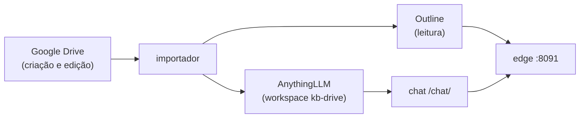

# Outline GDrive Wiki

[](LICENSE)

Base de conhecimento com o Google Drive como fonte: escreve no Drive, lê no Outline e pergunta num chat com citações.



Por que este projeto existe: o Outline é um ótimo wiki, mas não responde perguntas; o AnythingLLM responde, mas sem fonte confiável a resposta não serve. O importador liga os dois — espelha o Drive nos dois destinos — e o chat devolve resposta **com link e score da fonte**, ou diz "não encontrei".

## Quickstart

Pré-requisitos: Docker Desktop, Node 24+ (só para `npm run verify`), `.env` preenchido e JSON da service account do GCP. Passo a passo completo (GCP, chaves, boot, `seed`): [`docs/setup.md`](docs/setup.md).

```powershell
# 1. Configurar (uma vez)
Copy-Item src/infra/.env.example src/infra/.env   # preencher segredos
# DRIVE_SA_KEY_PATH = caminho do JSON da service account (fora do repo)

# 2. Subir e carregar
docker compose -f src/infra/docker-compose.yml up -d
docker compose -f src/infra/docker-compose.yml run --rm --no-deps import-drive seed

# 3. Abrir
# Wiki: http://127.0.0.1:8091
# Chat: http://127.0.0.1:8091/chat/
```

Manutenção diária:

```powershell
docker compose -f src/infra/docker-compose.yml run --rm --no-deps import-drive apply   # incremental
docker compose -f src/infra/docker-compose.yml run --rm --no-deps import-drive verify  # convergência (exit 1 = divergência)
```

Sem HTTPS público o sincronismo roda por poll a cada 15 minutos; o `apply` força na hora.

## Como funciona

| Preciso… | Abra |
|---|---|
| Subir do zero (GCP, `.env`, `seed`) | [`docs/setup.md`](docs/setup.md) |
| Usar o wiki ou o chat | Suba a stack (acima) — login local em [`docs/runbook.md`](docs/runbook.md) |
| Entender como as peças se ligam | [`docs/architecture.md`](docs/architecture.md) |
| Operar: backup, incidentes, credenciais | [`docs/runbook.md`](docs/runbook.md) |
| Saber quem pode o quê, onde moram segredos | [`docs/security.md`](security.md) |
| Saber por que uma decisão foi tomada | [`docs/adr/`](docs/adr/) |
| Mexer no código | [`src/AGENTS.md`](src/AGENTS.md) + README de cada serviço |

Estrutura:

| Pasta | O quê |
|---|---|
| `apps/importer/` | Espelha Drive → Outline + AnythingLLM ([detalhes](apps/importer/README.md)) |
| `apps/chat/` | Pergunta/resposta com fontes ([detalhes](apps/chat/README.md)) |
| `packages/` | Compartilhado: `@repo/env`, `@repo/logger`, `@repo/http`, `@repo/typescript-config` |
| `src/infra/` | Compose, edge openresty, scripts de backup e atualização |
| `src/content/normalize/` | Padrão editorial dos documentos |
| `docs/` | Arquitetura, operação, segurança e decisões |

O chat (`POST /ask`) devolve a melhor resposta com `sources[]` (link + score) ou `notFound` abaixo do corte (`CHAT_MIN_SCORE`). Por workspace, o melhor top-score vence; erro num workspace degrada sem derrubar.

## Contribuindo

1. Leia [`src/AGENTS.md`](src/AGENTS.md) e [`docs/CONTRIBUTING.md`](docs/CONTRIBUTING.md).
2. `npm run verify` na raiz (ou `--workspace` do que você tocou) — gate: `tsc` + `check-rules` + testes (tudo com mock, nada de API real).
3. Mudou comportamento, mudou o doc correspondente no mesmo commit.
4. Nada de segredo em código, fixture, log ou doc.

## Licença

MIT — ver [`LICENSE`](LICENSE).
