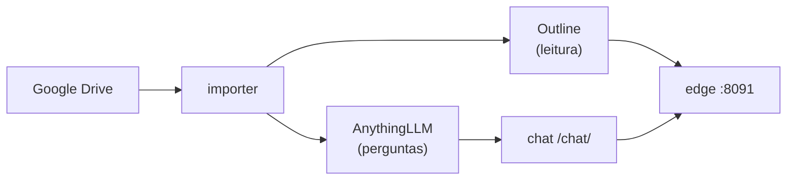

# Outline GDrive Wiki

[](LICENSE)

Wiki com busca + chat com citações, alimentados pelo Google Drive. Escreve no Drive, lê no Outline, pergunta no chat — o importador mantém os dois destinos em sincronia.



- **Primeira vez aqui?** → [`docs/setup.md`](docs/setup.md) (30 min: GCP, `.env`, `seed`, checagem)
- **Operando?** → [`docs/runbook.md`](docs/runbook.md) (backup, incidentes, credenciais)
- **Entendendo as decisões?** → [`docs/architecture.md`](docs/architecture.md) (por que Drive + Outline + RAG)
- **Contribuindo?** → [`docs/CONTRIBUTING.md`](docs/CONTRIBUTING.md) (gate, regras, PR)

```bash
cp src/infra/.env.example src/infra/.env   # Windows: Copy-Item (ver setup.md)
docker compose -f src/infra/docker-compose.yml up -d
docker compose -f src/infra/docker-compose.yml run --rm --no-deps importer seed
# Wiki: http://127.0.0.1:8091 · Chat: http://127.0.0.1:8091/chat/
```

MIT — ver [`LICENSE`](LICENSE).
