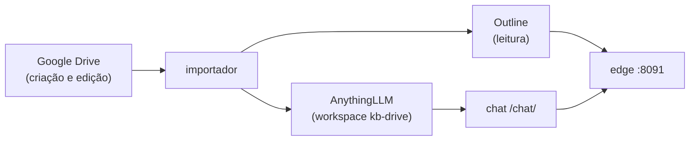

# Outline GDrive Wiki

Base de conhecimento com o Google Drive como fonte: os documentos nascem no Drive, aparecem para leitura no Outline e respondem perguntas em linguagem natural num chat com citações.



Nada aqui é editado no git — o git guarda infra, código e esta documentação. O conteúdo vive no Drive.

## Começando agora

Pré-requisitos: Docker Desktop, Node 24+ (só para `npm run verify`), `.env` preenchido a partir de `.env.example` e o JSON da service account do GCP no caminho de `DRIVE_SA_KEY_PATH`. No projeto GCP: Drive API + Docs API habilitadas.

```powershell
Copy-Item src/infra/.env.example src/infra/.env   # preencher segredos
docker compose -f src/infra/docker-compose.yml up -d
docker compose -f src/infra/docker-compose.yml run --rm --no-deps import-drive seed
```

Depois disso:

- Wiki: http://127.0.0.1:8091
- Chat: http://127.0.0.1:8091/chat/

Carga incremental e verificação de convergência:

```powershell
docker compose -f src/infra/docker-compose.yml run --rm --no-deps import-drive apply
docker compose -f src/infra/docker-compose.yml run --rm --no-deps import-drive verify
```

Sem HTTPS público o sincronismo roda por poll a cada 15 minutos; o `apply` força na hora. Detalhes em [`docs/runbook.md`](docs/runbook.md).

## Onde está cada coisa

| Pasta | O quê |
|---|---|
| `src/infra/` | Compose, edge, scripts de backup e atualização |
| `src/import-drive/` | Espelha Drive → Outline + AnythingLLM |
| `src/chatui/` | Pergunta/resposta com fontes |
| `src/content/normalize/` | Padrão editorial dos documentos |
| `docs/` | Arquitetura, operação, segurança e decisões |
| `plans/` | Visão do produto e contrato do importador |

## Para onde ir

- Quero **usar**: suba a stack (acima) e abra o wiki. Login local: `docs/runbook.md`.
- Quero **operar** (backup, incidentes, credenciais): [`docs/runbook.md`](docs/runbook.md).
- Quero **entender como as peças se ligam**: [`docs/architecture.md`](docs/architecture.md).
- Quero **saber por que é assim**: [`docs/adr/`](docs/adr/).
- Quero **mexer no código**: [`src/AGENTS.md`](src/AGENTS.md) e o README de cada serviço.

## Licença

MIT — ver [`LICENSE`](LICENSE).
