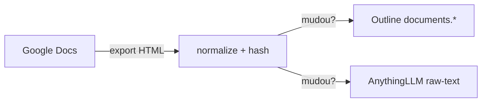

# importer — Drive → Outline + AnythingLLM

Lê Google Docs de um Drive compartilhado e escreve, independente e idempotente, no Outline e no AnythingLLM (`kb-drive`). Webhook (`changes.watch`) é o gatilho; `apply`/poll é o fallback.



Formato `raw-text`: `{ textContent, metadata: { title, url, description, origin: "drive" } }`.

- Entram só Google Docs; pastas ignoradas via `IMPORT_DRIVE_IGNORE_FOLDERS`; pasta sem coleção homônima cai na default (`OUTLINE_DEFAULT_COLLECTION_ID`).
- Gatilho: webhook (`changes.watch` → `POST /hooks/drive`); fallback `apply`/poll; canal renovado antes de 7 dias.
- Idempotência por hash; `verify` compara Drive ↔ estado ↔ workspace (exit 1 = divergência).
- Imagens: rewrite para `/drive-image/<docId>/<objectId>`, `contentUri` via Docs API (`documents.readonly`), cache de 20 min, nada em disco.
- Segredo fora do git; teste só com mock.
- Comandos via compose (`importer`) ou direto: `node apps/importer/dist/src/cli.js <seed|apply|verify|serve>`.

```powershell
npm run verify --workspace=@kb/importer
```

## Imagens inline

O export HTML traz imagem como data URI; o importador troca por `/drive-image/<docId>/<objectId>` e o `serve` resolve o `contentUri` na Docs API (escopo `documents.readonly`, cache em memória de 20 min, nada em disco). Pré-requisito: Drive API + Docs API habilitadas. Doc fora do estado → 404; Docs API fora → 502. Fluxo em [`docs/architecture.md`](../../docs/architecture.md#imagens-inline).

## Env

Todas em `src/infra/.env.example`: `DRIVE_SA_KEY_PATH`, `DRIVE_ID`, `DRIVE_ROOT_FOLDER_ID`, `OUTLINE_API_URL`, `OUTLINE_API_KEY`, `OUTLINE_COLLECTION_MAP`, `OUTLINE_DEFAULT_COLLECTION_ID`, `ANYTHINGLLM_*`, `IMPORT_DRIVE_RAG_WORKSPACE`, `DRIVE_WEBHOOK_*`, `DRIVE_POLL_INTERVAL_MS`, `IMPORT_DRIVE_IGNORE_FOLDERS`, `IMPORT_CONCURRENCY`, `STATE_DATABASE_URL`, `OUTLINE_PUBLIC_URL`.

## Camadas

```
domain     normalize, images, hash (só stdlib)
ports      contratos (drive, docs, outline, rag, state)
usecases   importação, carga inicial, incremental, verify
commands   seed, apply, verify, serve
infra      config, clients, state store, webhook
```

Gate: `npm run verify` na raiz (tsc + check-rules + testes, tudo com mock, nada de API real).
