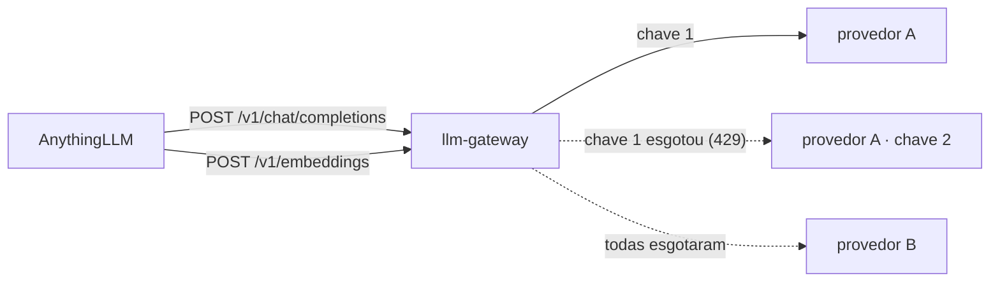

# llm-gateway — rotação de cota entre chaves e provedores

Proxy OpenAI-compatível que fica **entre o AnythingLLM e os provedores LLM**. Quando uma chave responde `429` (cota/rate limit), ela sai de rotação por um cooldown e a próxima assume; quando todas as chaves de um provedor esgotam, ele passa para o próximo provedor da lista. É assim que cotas gratuitas de várias contas somam numa só API interna.



## Contrato

| Rota | Body | Repassa para |
|---|---|---|
| `POST /v1/chat/completions` | Chat Completions (streaming incluso) | `<base>/chat/completions` |
| `POST /v1/embeddings` | Embeddings | `<base>/embeddings` |
| `GET /healthz` | — | estado das chaves (total, em cooldown, retorno em ms) |

`Authorization: Bearer $LLM_GATEWAY_TOKEN` quando o token está definido. Qualquer status que não seja `429` volta ao chamador sem retry — só cota rotaciona. `429` de todas as rotas devolve `429` com o `Retry-After` do provedor.

O gateway reescreve `model` e, em embeddings, `dimensions` (`LLM_GATEWAY_EMBEDDING_DIMENSIONS`, padrão 2048). Isso mantém o vetor gravado no LanceDB compatível mesmo quando a chave cai em outra conta.

## Env

Todas em `src/infra/.env.example` (`LLM_GATEWAY_*`, `GEMINI_API_KEYS`, `GENERIC_*`). `LLM_GATEWAY_PROVIDERS` define a ordem de fallback (padrão `gemini`). Provedores suportados: `gemini` (endpoint OpenAI do Google) e `generic` (qualquer provedor OpenAI-compatível, ex. OpenRouter, Groq, LM Studio).

`GEMINI_API_KEYS=chave1,chave2,chave3` — ordem de preferência. `GEMINI_API_KEY` único continua aceito.

## Operação

- Chave em cooldown não volta sozinha antes de `LLM_GATEWAY_KEY_COOLDOWN_MS` (padrão 15 min). O estado vive em memória do processo: recriar o container libera todas as chaves.
- `GET /healthz` mostra quantas chaves estão em cooldown e em quanto tempo a primeira volta.
- A cota gratuita do Gemini é **por projeto/chave**; `429` no chat e nos embeddings são contabilizados separadamente pelo provedor.

```powershell
npm run verify --workspace=@kb/llm-gateway
```

Testes usam um upstream falso; **nunca** chamam Gemini real. Gate: `npm run verify` na raiz.
