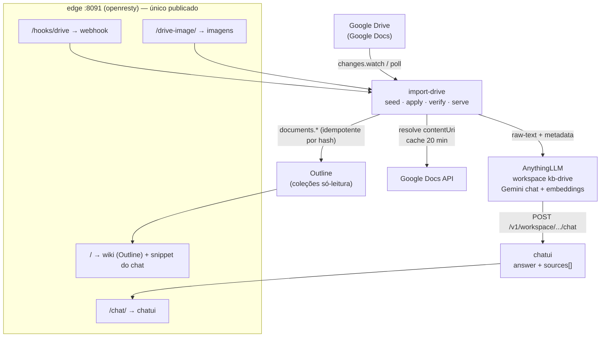
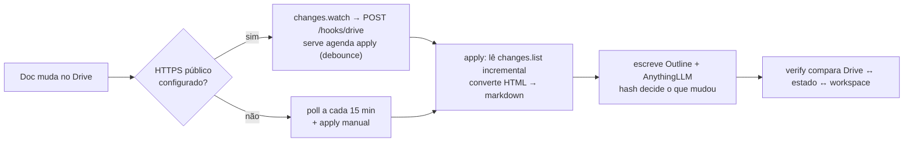
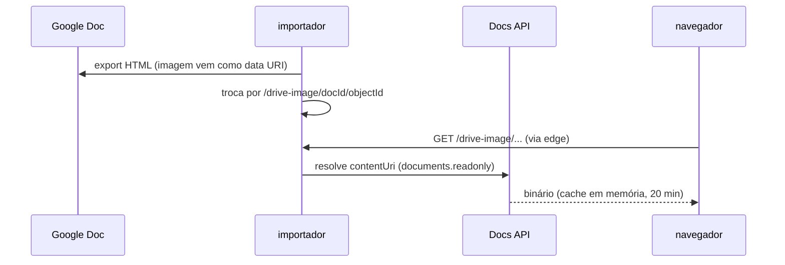
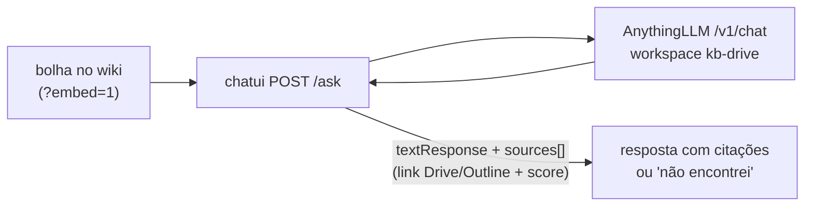

# Arquitetura

Três papéis bem separados: o Drive guarda a verdade, o Outline serve leitura, o AnythingLLM responde perguntas. O importador mantém os dois destinos em sincronia; o edge é o único ponto de entrada.

## Visão geral

| Peça | Papel | Detalhe de acesso |
|---|---|---|
| `apps/importer` | Espelha Drive → Outline e Drive → AnythingLLM; serve imagens | Único escrevente no Outline; lê o Drive com `drive.readonly` |
| `apps/chat` | Pergunta/resposta sobre `/v1/chat`, devolve resposta com fontes | API key só no backend; corta abaixo de `CHAT_MIN_SCORE` |
| edge (openresty) | Wiki + chat + webhook + imagens num ponto | Ver [`security.md`](security.md); limites em [`runbook.md`](runbook.md) |
| PostgreSQL / Redis | Persistência do Outline | Rede interna, sem porta publicada |

Composição completa dos serviços: `src/infra/README.md`.

## Importação

Regras de seleção: entram só Google Docs; pastas listadas em `IMPORT_DRIVE_IGNORE_FOLDERS` ficam fora; cada pasta espelha a coleção homônima (`OUTLINE_COLLECTION_MAP` por ID quando configurado), ou cai na coleção default (`OUTLINE_DEFAULT_COLLECTION_ID`). O canal do Drive expira em até 7 dias — o `serve` renova antes e expõe o estado em `GET /healthz`. Comandos em [`runbook.md`](runbook.md); formato `raw-text` e demais detalhes em `apps/importer/README.md`.

## Imagens inline

Fora do estado → 404; Docs API fora → 502. Pré-requisito no GCP: Drive API + Docs API habilitadas. Diagnóstico em [`runbook.md`](runbook.md).

## Pergunta

O widget nativo do AnythingLLM não devolve `sources` — por isso a UI própria é o único caminho (ver ADR 0002). Limites e erros: [`runbook.md`](runbook.md).

## Limites assumidos

- Outline não tem busca vetorial: serve leitura, não pergunta.
- Sem autenticação por documento na v1 — quem alcança o chat vê o acervo inteiro (ver [`security.md`](security.md)).
- Produção expõe 22/80/443; Postgres, Redis, AnythingLLM e importador nunca publicam porta.

Decisões que explicam o "porquê": [`adr/`](adr/).
