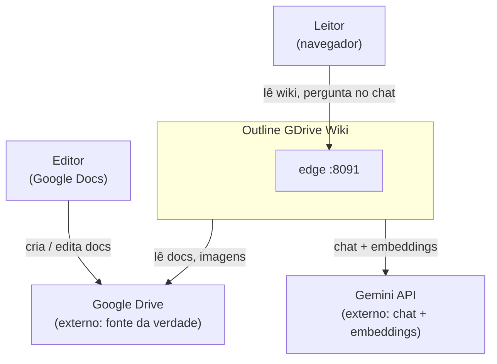
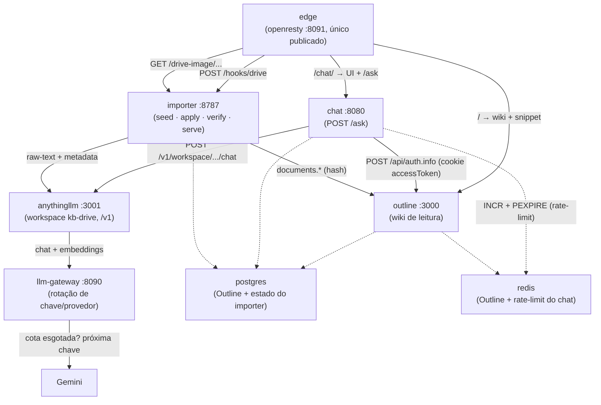
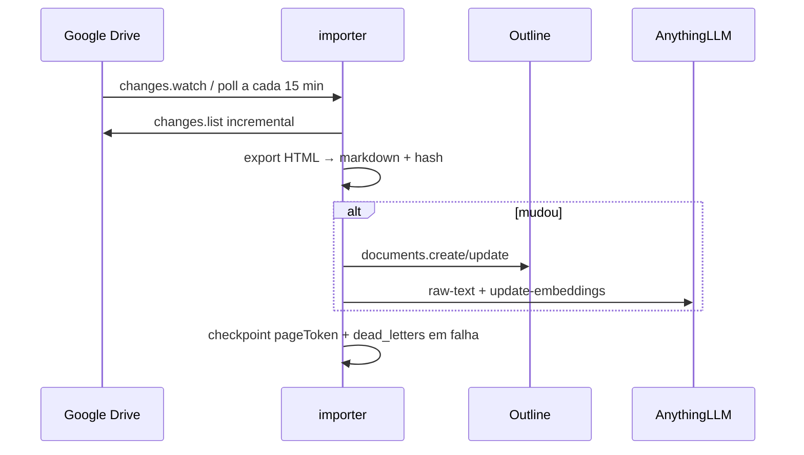
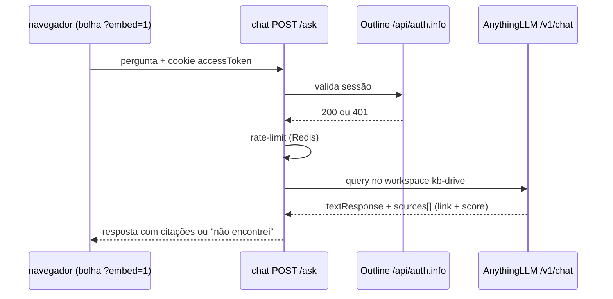

# Arquitetura

Por que este sistema existe e como as peças se ligam. Comandos ficam no [`runbook.md`](runbook.md); passo a passo de instalação no [`setup.md`](setup.md).

Três papéis bem separados: o Drive guarda a verdade, o Outline serve leitura, o AnythingLLM responde perguntas. O importer mantém os dois destinos em sincronia; o edge é o único ponto de entrada.

## Contexto

Quem usa o sistema e o que está fora dele:

O sistema nunca escreve no Drive — só lê (`drive.readonly` + `documents.readonly`). A IA é 100% remota via API; nada de modelo local.

## Containers

O que roda no Compose e como se fala (nomes iguais aos serviços em `src/infra/docker-compose.yml`):

No Compose, o chat espera `outline`, `anythingllm` e `redis` ficarem healthy antes de subir.

| Peça | Papel | Detalhe |
|---|---|---|
| `apps/importer` | Espelha Drive → Outline e Drive → AnythingLLM; serve imagens | Único escrevente no Outline |
| `apps/chat` | Pergunta/resposta sobre `/v1/chat`, devolve resposta com fontes | API key só no backend; valida sessão do Outline em toda rota exceto `/healthz`; corta abaixo de `CHAT_MIN_SCORE` |
| `apps/llm-gateway` | Roteia chat e embeddings para os provedores LLM | Rotaciona chaves no 429 e troca de provedor quando todas esgotam; contrato em `apps/llm-gateway/README.md` |
| edge (openresty) | Wiki + chat + webhook + imagens num ponto | Ver [`security.md`](security.md) |
| PostgreSQL / Redis | Estado do importer + persistência do Outline; rate-limit do chat | Rede interna, sem porta publicada |

Detalhes de deploy (volumes, limites, overlays): `src/infra/README.md` e `src/infra/docker-compose.yml`.

## Importação

Como um doc novo chega aos dois destinos:

Regras de seleção: só Google Docs; pastas em `IMPORT_DRIVE_IGNORE_FOLDERS` ficam fora; cada pasta espelha a coleção homônima (`OUTLINE_COLLECTION_MAP` por ID) ou cai na default (`OUTLINE_DEFAULT_COLLECTION_ID`). A citação enviada ao RAG aponta para `${OUTLINE_PUBLIC_URL}/doc/<outlineId>`. O hash usa o schema `2` e inclui `OUTLINE_PUBLIC_URL`: trocar o schema invalida o estado anterior, e trocar a URL pública reindexa as citações no próximo `seed`. Canal do Drive expira em até 7 dias — o `serve` renova antes (`GET /healthz` mostra o estado). Doc com falha vai para `dead_letters` sem travar o resto. Detalhes de contrato em `apps/importer/README.md`.

## Imagens inline

O export HTML traz imagem como data URI; o importador troca por `/drive-image/<docId>/<objectId>` e o `serve` resolve o `contentUri` na Docs API (cache em memória de 20 min, nada em disco). Fora do estado → 404; Docs API fora → 502.

## Pergunta

O widget nativo do AnythingLLM não devolve `sources` — por isso a UI própria é o único caminho (ver ADR 0002). Limites e erros: [`runbook.md`](runbook.md).

## Cota do LLM

O AnythingLLM não fala com o Gemini direto: aponta para o `llm-gateway`, que guarda as chaves. Cada `429` tira a chave de rotação por um cooldown e passa para a próxima; quando todas esgotam, o gateway desce para o próximo provedor de `LLM_GATEWAY_PROVIDERS`. `GET /healthz` do gateway mostra quantas chaves estão em cooldown. Contrato e env em `apps/llm-gateway/README.md`.

## Limites assumidos

- Outline não tem busca vetorial: serve leitura, não pergunta.
- Sem autenticação por documento — qualquer sessão válida do Outline alcança o acervo inteiro no chat (ver [`security.md`](security.md)).
- Produção expõe 22/80/443; Postgres, Redis, AnythingLLM, llm-gateway, chat e importer nunca publicam porta.

Decisões que explicam o "porquê": [`adr/`](adr/).
