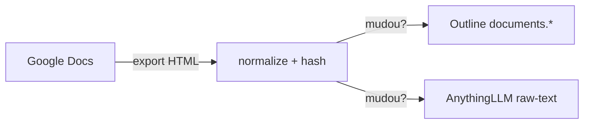

# Contrato do importador Drive → Outline + AnythingLLM

Google Docs do Drive compartilhado chegam a dois destinos independentes: **Outline** (leitura, sem write-back) e **AnythingLLM** (`kb-drive`). O chat (`POST /ask`) devolve a melhor resposta com `sources[]` (link para Drive ou Outline) ou `notFound` abaixo do corte.

Formato `raw-text`: `{ textContent, metadata: { title, url, description, origin: "drive" } }`.

- Entram só Google Docs; pastas ignoradas via `IMPORT_DRIVE_IGNORE_FOLDERS`; pasta sem coleção homônima cai na default (`OUTLINE_DEFAULT_COLLECTION_ID`).
- Gatilho: webhook (`changes.watch` → `POST /hooks/drive`); fallback `apply`/poll; canal renovado antes de 7 dias.
- Idempotência por hash; `verify` compara Drive ↔ estado ↔ workspace (exit 1 = divergência).
- Imagens: rewrite para `/drive-image/<docId>/<objectId>`, `contentUri` via Docs API (`documents.readonly`), cache de 20 min, nada em disco.
- Segredo fora do git; teste só com mock.

**Chat:** por workspace aplica `CHAT_MIN_SCORE`; melhor top-score vence, `sources[]` mescladas com `origin`; erro num workspace degrada sem derrubar.
